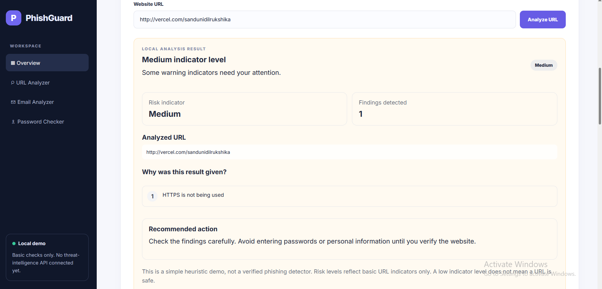
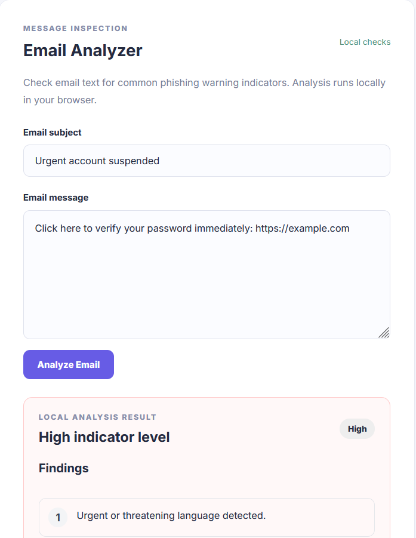
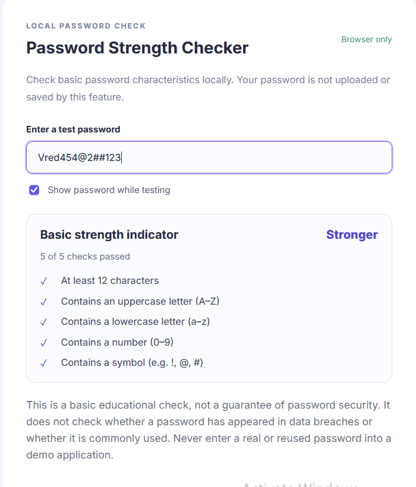
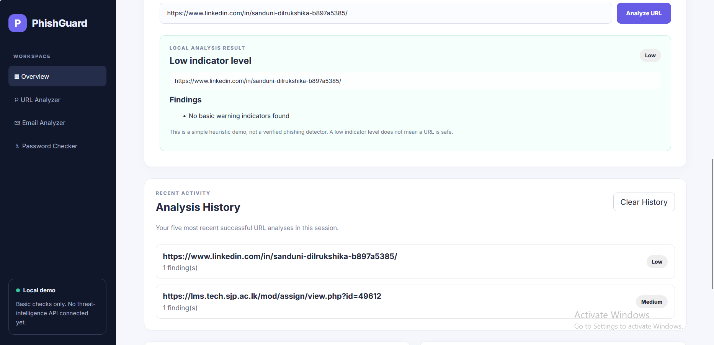

#

# \# PhishGuard

#


# PhishGuard is an educational cybersecurity web application that helps users

# inspect URLs and email text for common phishing warning indicators and check

# basic password characteristics.

#

# \## Features

#

# \- \*\*URL Analyzer:\*\* Identifies basic URL warning indicators.

# \- \*\*Email Analyzer:\*\* Checks email subject and body text for suspicious wording

# &#x20; and extracts visible HTTP/HTTPS URLs.

# \- \*\*Password Strength Checker:\*\* Checks password length and character variety

# &#x20; locally in the browser.

# \- \*\*Scan History:\*\* Keeps up to five recent URL analysis results in browser

# &#x20; local storage.

#

# \## Technology Stack

#

# \- React

# \- TypeScript

# \- Vite

# \- Python

# \- Flask

# \- Flask-CORS

#

# \## Running Locally

#

# \### Backend

#

# 1\. Open PowerShell in the project root.

# 2\. Activate the Python virtual environment:

#

# &#x20;  ```powershell

# &#x20;  .\\backend\\.venv\\Scripts\\Activate.ps1

# &#x20;  ```

#

# 3\. Start the Flask API:

#

# &#x20;  ```powershell

# &#x20;  python .\\backend\\app.py

# &#x20;  ```

#

# The backend runs at `http://127.0.0.1:5000`.

#

# \### Frontend

#

# Open a second PowerShell window:

#

# ```powershell

# Set-Location "E:\\PhishGuard\\frontend"

# npm run dev

# ```

#

# Open the local URL printed by Vite, usually `http://localhost:5173/`.

#

# \## Validation

#

# Build the frontend:

#

# ```powershell

# npm run build

# ```

#

# Run lint checks:

#

# ```powershell

# npm run lint

# ```

#

# \## Security and Limitations

#

# PhishGuard is an educational demonstration, not a production-grade phishing

# detection service.

#

# \- URL and email results are heuristic indicators and may produce false

# &#x20; positives or miss malicious content.

# \- A low-risk result does not prove that a URL or email is safe.

# \- The password checker performs basic checks only; it does not check breached

# &#x20; password databases or guarantee password security.

# \- Do not enter real passwords, credentials, one-time codes, or confidential

# &#x20; email content into this demo.

# \- Scan history is stored in browser local storage and is not a secure

# &#x20; long-term record system.

#

# \## Project Status

#

# Core educational demo features are implemented. Further improvements and

# deployment can be added in future development.

#
## Screenshots

### URL Analyzer


### Email Analyzer


### Password Strength Checker


### URL Scan History

